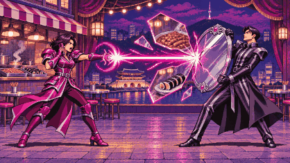
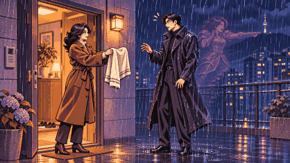
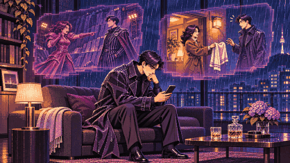
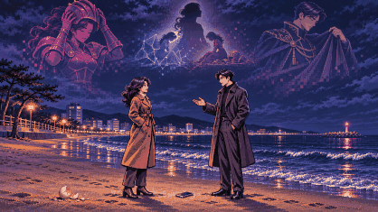
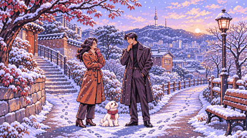

# 핑크는 통화 중

사건 구조 재구성 · 6장 시나리오 초안

**핵심 장치**  모경의 분노는 실제다. 전사와 괴수, 폭발과 얼음은 제범의 머릿속 화면이다. 모경은 특촬 놀이를 하는 사람이 아니다. 두 사람이 화해한 뒤에야 그 이미지를 둘만의 장난으로 쓸 수 있다.

**장 순서**  사랑, 두려움 → 나를 돌아봐 → 우리는 → 다투고 난 뒤 → 또 하루 → 굴레를 벗어나

---

## 제1장. 사랑, 두려움

### S#1. 강릉 바닷가 / 밤

화면은 깜깜하다. 전화 연결음 뒤로 파도 소리가 들어온다. 모경의 목소리가 먼저 들린다.

**모경(전화)**  지금 네 얼굴이 보여. 조금만 더 가까이 오면 내가 말을 못 할 수도 있어.

멀리, 모래사장에 선 제범이 보인다. 휴대전화 화면에는 분홍색 마스크와 하얀 개가 함께 있다. 제범은 한 발을 내딛으려다 멈춘다.

**제범**  그럼 여기 있을게. 끝까지 듣고 싶어.

모경의 입에서 다음 말이 나오기 직전, 화면이 끊긴다.

자막. **세 주 전.**

### S#2. 제범의 차 / 낮

모경이 조수석에서 피보를 안고 강릉 숙소 사진을 보여 준다. 피보가 뛰어놀 수 있는 작은 마당이 있다.

**모경**  여기서 자고 아침에 바다 걷는 거 어때? 피보도 같이.

제범은 운전하면서 사진을 흘낏 본다. 도착까지 세 시간, 주말 고속도로 정체 표시가 내비게이션에 뜬다.

**제범**  네가 요새 많이 피곤하잖아. 내가 편한 데 알아볼게.

**모경**  이 숙소는—

**제범**  응, 저장해 둬. 내가 비교해 볼게.

모경은 입을 닫는다. 제범은 그녀가 동의했다고 받아들인다. 피보만 조수석 안전벨트 사이에서 바닷바람 대신 자동차 바람을 맡는다.

### S#3. 제범의 집 / 이틀 뒤 / 저녁

제범이 예약 완료 화면을 보여 준다. 서울 도심 호텔, 피보를 위한 돌봄 서비스.

**제범**  취소 수수료도 없어. 마음에 안 들면 바꾸면 돼.

그는 말하면서도 이미 달력에 호텔 날짜를 입력한다. 모경은 지도를 열어 서울과 강릉 사이를 손가락으로 움직인다.

**모경**  피보를 맡기려고 했어?

**제범**  우리 둘이 쉬자는 뜻이지. 피보도 좋은 데 있을 거야.

**모경**  알았어.

피보는 모경이 꺼내 둔 산책 가방에 앞발을 얹는다. 모경은 가방을 치우지 않는다. 대신 제범의 얼굴을 본다. 그가 자신을 기쁘게 했다고 믿는 표정이다.

### S#4. 지하주차장과 모경의 집 / 같은 저녁

엘리베이터가 오기까지 스물세 층이 남았다. 모경은 피보의 가방 속에서 접힌 종이가 삐져나온 걸 발견한다. 자기가 그린 강릉 지도다. 차에선 숙소 사진만 보여 줬고 이 종이는 펼쳐 보지도 못했다.

지도에는 운전 교대 지점 두 곳, 강아지가 들어갈 수 있는 식당 한 곳, 해 뜨기 전에도 문이 열려 있는 해변 입구가 표시돼 있다. 제범이 전에 바다 근처에서 잠을 못 잔다고 해서 숙소는 해변에서 조금 떨어진 곳으로 골랐다. 그가 쉬었으면 한다는 생각은 그녀도 했다.

모경은 엘리베이터 호출 버튼 위로 손을 뻗다 몸을 돌린다. 지금 올라가 다시 설명하면 될 일이다. 그때 제범에게 메시지가 온다. 호텔 수영장 사진에 이어 ‘네가 좋아해서 나도 좋다’는 문장. 모경은 지도에 찍어 둔 점들을 엄지로 가린다.

**모경(혼잣말)**  좋아한다고 말 안 했어.

아무도 없는 지하주차장에서 목소리가 너무 쉽게 나온다. 모경은 한 번 더 말해 본다. 크게 해도 아무도 그녀를 보지 않는다.

집에 돌아와 피보에게 물을 주고, 지도는 식탁에 펼쳐 둔다. 그녀는 제범에게 보낼 메시지를 쓴다. ‘사실 나는 강릉에 가고 싶어.’ 뒤에 ‘네가 괜찮으면’을 붙였다가 지운다. 문장을 전부 지우자 빈 입력창 위에 피보의 얼굴이 남는다.

거실 서랍을 열어 오래된 사진 봉투를 꺼낸다. 초등학교 운동회날, 하루는 노란 손수건을 머리에 묶고 모경은 분홍색 종이 가면을 손에 든 채 서 있다. 사진 뒤에는 엄마 글씨로 ‘고집쟁이 모모’라고 적혀 있다. 핀잔처럼도, 애칭처럼도 읽힌다. 모경은 휴대전화에 따로 저장해 두었던 분홍 마스크 그림을 띄운다. 사진을 바꿀 때만 해도 자신이 어느 정도까지 화를 내고 싶은지는 모른다.

### S#5. 두 집 / 밤 / 보이스톡

제범의 휴대전화에서 피보 사진이 사라지고 분홍색 마스크 프로필이 나타난다. 그는 낯선 번호인 줄 알고 잠깐 망설인다. 이름은 ‘모경’이다.

**제범**  프사 바꿨네.

**모경**  내 얘기를 들은 게 하나라도 있어?

제범은 농담인 줄 알고 웃으려 한다. 모경이 그 틈을 끊는다.

**모경**  내가 바다에 가자고 했어. 피보와 함께. 넌 그 두 가지를 다 빼고 네가 정한 호텔을 내 앞에 내놨어. 그런 다음 마음에 안 들면 바꾸자고 했지. 네가 이미 고른 답을 내가 거절하는 사람이 되게 만든 거야.

**제범**  네가 쉬었으면 해서—

**모경**  또 내 상태를 네가 설명하네. 내가 피곤하다고 했지, 바다에 가기 싫다고 했어?

전화 속 모경의 목소리가 높아진다. 제범의 방 벽이 잠깐 특촬 촬영장의 바위 절벽으로 변한다. 핑크 전사의 실루엣이 폭풍 속에서 일어난다. 제범은 줄무늬 괴수 ‘도글러’가 되어 뒷걸음친다.

**핑크(제범의 상상)**  남의 말을 지우는 괴수, 박멸!

핑크가 손을 뻗는 순간 현실의 제범은 손바닥으로 귀에서 휴대전화를 떨어뜨릴 뻔한다. 방은 원래대로다. 모경은 특촬 대사가 아니라 여행 이야기를 하고 있다.

**모경(전화)**  대답해. 내가 뭐라고 했는지.

**제범**  피보랑 강릉 바다를 걷고 싶다고.

잠깐 침묵. 모경은 더 화를 낼 수 있지만 그러지 않는다.

**모경**  그건 들었네.

통화가 끝난다. 제범은 휴대전화를 내려놓지 못한다.

### S#6. 거리 / 다음 날 / 낮

모경은 피보와 함께 제범을 기다린다. 어젯밤을 모르는 사람처럼 웃는다. 제범은 그 웃음이 무서워진 자신을 보고 더 놀란다.

**제범**  어제 전화… 기억하지?

**모경**  응. 취소하라고 한 적 없는 것도 기억해. 네가 내 말을 되풀이한 것도.

그녀는 피보에게 물을 먹인다. 제범은 ‘다른 사람’이 된 게 아니라고 확인한다. 그럼에도 무슨 일이 일어났는지는 모른다.

### S#7. 반려견 놀이터 입구 / 같은 날

피보가 울타리 안에서 다른 개들을 보다가 제범의 다리 뒤로 숨는다. 제범은 입장권 두 장을 이미 끊었다. 모경이 표를 받아 들지도 않고 기다리자, 제범도 그제야 허리를 굽혀 개를 본다.

**제범**  들어가면 또 잘 놀지 않을까?

**모경**  그럴 수도 있지. 지금은 싫은가 봐.

제범은 표를 주머니에 넣고 피보 근처에 앉는다. 잠시 뒤 피보는 제범의 구두 냄새를 맡고 인도 쪽으로 먼저 간다. 세 사람은 결국 두 블록을 돈다. 모경은 이 정도면 됐다고 말한다. 제범이 웃으면서도 여전히 휴대전화를 손에 쥐고 있는 걸 본다.

**모경**  어제 내가 무서웠어?

**제범**  네가 화난 건 알겠어.

묻는 말에 바로 대답하지 않은 건 제범 쪽이다. 피보가 나무 밑에서 멈추자 둘도 멈춘다. 길 건너편 카페에 어제 이야기한 호텔 광고가 붙어 있다. 제범은 그 광고를 보고도 호텔을 꺼내지 않는다. 모경은 한 발 먼저 가고, 제범이 따라오지 않는 아주 짧은 사이에 뒤를 돌아본다. 그는 쓰레기통에 입장권을 버리고 있다.

---

## 제2장. 나를 돌아봐

### S#8. 회사 휴게실 / 낮

명재희의 가방에 파란 마스크맨 열쇠고리가 달려 있다. 제범은 아무렇지 않은 척 옆에 선다.

**제범**  거기서 핑크는 어떤 캐릭터야?

**재희**  되게 정면으로 가죠. 상대가 변명하면 더 세게 붙고요. 그런데 왜요?

**제범**  그냥. 오래돼서 기억이 안 나.

재희는 괴수 도글러가 매번 쓰러져도 돌아오고, 진짜 권력자는 제바 황제였다고 설명한다. 제범은 자기 이름과 닮은 이름을 듣고 헛웃음을 짓는다.

### S#9. 고깃집 / 일 년 전 / 밤

제범의 기억. 연애 초기에 두 사람이 고기를 굽는다. 옆자리 연인의 큰소리가 점점 거칠어진다. 제범이 고개를 돌린다.

**제범**  저렇게 얼굴 보고 싸우면 다음 날 어떻게 만나냐. 우리 싸우더라도 전화로 하자.

그는 가볍게 말하고 물을 마신다. 모경의 얼굴은 기억 속에서 선명하지 않다. 제범은 그날 자신이 한 말을 중요한 약속으로 여기지 않았다.

### S#10. 고깃집 밖과 동물병원 / 일 년 전 / 같은 밤

고깃집에서 나오자 피보를 맡아 준 하루에게 전화가 온다. 피보가 사료를 토했고, 자기 차는 동생이 가져갔다고 한다. 모경이 호출 앱을 열다 휴대전화를 떨어뜨린다.

**제범**  내가 데려다줄 수 있어. 같이 갈까?

그가 차 열쇠를 꺼내면서도 문을 먼저 열지 않고 서 있다. 모경은 현관으로 나오는 데 몇 분 걸릴 거라 말한다. 제범은 그럼 여기서 기다리겠다고 한다. 그날 모경은 그 대답이 마음에 들었다.

동물병원에서는 보호자 한 명만 진료실에 들어갈 수 있다. 제범은 피보의 가방을 받아 안고 밖에 남는다. 모경이 나왔을 때 가방의 열려 있던 지퍼를 잠그고 담요는 손이 닿는 데에 빼 두었다. 피보는 심각한 상태가 아니었다. 그래도 모경은 대기실 의자에 앉기 전까지 무릎이 떨리는 걸 몰랐다.

**모경**  나 때문에 저녁도 다 못 먹었잖아.

**제범**  나 아까 고기보다 밥 많이 먹어서 괜찮아. 너는 배고프지?

**모경**  배고파. 근데 나는 지금 뭘 사러 갈 기운이 없어.

**제범**  그럼 내가 갔다 와도 돼?

그는 편의점에 갔다 와 모경 앞에 삼각김밥 두 개를 놓는다. 그녀는 참치를 고른다. 제범은 남은 걸 먹는다. 둘 사이 휴대전화에는 축 늘어진 피보의 사진이 있다. 제범이 그걸 보고 ‘오늘의 환자’라고 이름을 붙인다. 모경이 웃다가 코를 훌쩍인다. 제범은 휴지를 건네고, 웃음이 날 때까지 기다린다.

시간이 지나면 남는 기억은 사람마다 다르다. 제범에게 그날 밤은 자신이 모경에게 도움이 된 첫날이다. 모경에게는 겁을 먹고도 자기 속도를 지킬 수 있었던 날이다. 두 사람 다 그 밤을 좋아한다. 옆자리에서 싸우던 두 사람 이야기는 서로 다시 꺼내지 않는다.

### S#11. 모경의 집 주방 / 현재 / 낮

모경은 피보가 어렸을 때 썼던 목줄을 빨아 베란다에 넌다. 손바닥 길이만 한 분홍색 줄이다. 처음 같이 산책하던 날 제범이 매듭을 잘못 묶어 피보가 놀이터를 통째로 한 바퀴 돌았던 일이 떠오른다. 그때 제범은 자기 실수를 인정하는 대신 개가 작아서 빠져나갔다고 우겼다. 따라 뛰던 모경이 너무 웃어 나중에는 자기도 뛰지 못했다.

씻어 둔 그릇 옆에 제범이 두고 간 물컵이 있다. 그 컵을 따로 챙기는 일은 여전히 좋다. 그러나 저녁에 피보 병원 예약을 바꿨다는 문자를 받자 모경은 컵을 싱크대에 다시 올려놓는다.

제범은 그녀의 야근 일정을 보고 시간을 늦춰 두었다. 모경은 그날 일찍 끝난다고 말했으나 제범은 일정표를 보고 자신이 다시 확인해 주겠다고 했다. 병원에서는 보호자 연락처가 둘이면 누구의 확인을 받아야 하냐고 물어본다.

**모경(전화)**  그 시간은 원래대로 부탁드려요. 제가 갈 거예요.

그녀는 병원에는 단번에 대답한다. 제범에게 보내는 문장은 세 번 고친다. 마침내 ‘병원은 내가 원래 시간으로 돌려놨어’를 보낸다. 돌아온 답은 ‘오케이. 그럼 저녁만 내가 잡을게.’ 모경은 그 문장을 읽고도 그날 다시 전화를 걸지 않는다. 하루에 한 가지라도 지키는 데 온 기운이 든다.

### S#12. 모경의 집 / 낮

모경은 제범에게 피보의 첫 산책 사진을 보여 주려다 휴대전화를 내려놓는다. 화면에 열린 메모 제목 ‘표정’이 스친다. 그녀는 급히 앱을 닫고 사진을 연다. 제범은 제목을 본 것 같지만 묻지 않는다.

### S#13. 분식집 / 저녁

제범은 작은 문제부터 바로잡기로 한다.

**제범**  오늘 메뉴 네가 골라. 정말로.

**모경**  순한 떡볶이랑 김말이.

**제범**  좋아. 그런데 여긴 보통 맛이 맛있는데, 한 접시만 그렇게 할까? 오징어튀김도 방금 나왔대.

직원이 앞에 선다. 제범은 잠깐 모경을 보지만 그녀는 이미 ‘아무거나’라는 얼굴이다. 그는 보통 맛을 주문한다. 메뉴가 나오자 모경은 아무렇지 않게 먹는다.

그날 밤. 핑크 프로필의 전화.

**모경(전화)**  네가 ‘우리’라고 말할 때 내가 어디 있는지 모르겠어.

**제범**  오늘은 물어봤잖아.

**모경**  물어본 다음 네 답으로 주문했지. 내가 또 거절하면 내가 예민한 사람이 되니까.

제범의 상상 속 도글러는 ‘우리’라고 쓰인 방패를 든다. 핑크가 방패를 두 동강 낸다. 현실에서 제범은 땀에 젖은 손바닥으로 휴대전화를 바꿔 쥔다.

### S#14. 모경의 집 앞 / 다음 날 / 비

통화로 싸우던 중 제범이 모경의 집 앞에 도착한다. 문을 열자 그녀는 말을 멈춘다. 분노가 꺼진 게 아니라, 입 밖으로 나오는 길을 잃은 것처럼 보인다.

**모경**  비 오는데 왜 우산 없이 왔어?

**제범**  방금 하던 말, 여기서 해도 돼.

모경은 수건을 가져와 그의 어깨에 건넨다.

**모경**  지금은 그 말이 안 나와.

제범은 속으로 ‘핑크가 가면을 벗었다’고 생각한다. 모경은 같은 사람이고 같은 옷을 입고 있는데도, 그의 머릿속에서만 조명이 바뀐다.

### S#15. 모경의 집 식탁 / 비가 그친 뒤

배달 상자에 종이 숟가락이 하나만 들어 있다. 모경은 부엌 서랍에서 숟가락 두 개를 꺼내고, 하나를 제범 쪽에 놓는다. 제범은 수건을 무릎 위에 접어 둔 채 물을 마신다.

**제범**  나 아까는 네 전화가 끊기면 다시 걸려고 했어. 얼굴 보자고 하면 무슨 일인지 알 것 같았거든.

**모경**  그런데 와 버렸지.

제범이 숟가락을 들다 놓는다. 모경의 말은 작고 분명하다. 그 한마디 뒤로 그녀가 덧붙인 ‘수건은 젖었으면 여기 둬’가 이어진다.

**제범**  갑자기 찾아오는 게 싫었으면 다음에는 전화로 물을게.

**모경**  이번에는 내가 문을 열었으니까 됐어.

‘됐어’가 좋았다는 말인지 더 말할 기운이 없다는 말인지 제범은 구별하지 못한다. 그는 다시 캐묻는 대신 국을 한 입 먹는다. 여기서 둘이 할 수 있는 가장 쉬운 일이다.

빗물이 베란다 난간에서 떨어진다. 모경이 소리가 좋다고 한다. 제범도 좋아한다고 말하려다 자기는 저 소리를 들으면 창문이 샐까 걱정된다고 한다. 모경은 그제야 조금 웃는다.

**모경**  그런 얘기는 맨날 하는데.

**제범**  어떤 얘기?

모경은 ‘서로 다른 얘기’라고 말하려다 입을 다문다. 젖은 종이 상자만 눌러 접는다. 제범이 분리수거를 들고 나간 뒤 그녀는 수건을 넌다. 물기가 너무 많아 바닥에 떨어진다. 그녀는 아래에 마른 수건을 하나 더 받친다.

---

## 제3장. 우리는

### S#16. 동네 카페 / 주중 / 저녁

두 사람은 이번에는 같은 테이블에서 강릉 숙소를 다시 찾는다. 제범이 서울 예약을 취소했다고 하자 모경은 고개를 끄덕인다. 환불 문자가 오고도 제범은 화면을 뒤집지 않는다. 그 화면을 보면 자기 쪽의 일이 끝났다고 믿을 수 있다.

**모경**  내가 찾은 곳은 마당이 있어. 피보는 아침에 한 번 나갔다 들어와야 밥을 먹거든.

**제범**  응. 대신 바다랑 멀어서 왔다 갔다 해야 되지 않아? 이쪽은 걸어서 삼 분이야.

**모경**  거기는 강아지 안 된다고 써 있어.

제범은 아래로 화면을 내려 본다. 작은 글씨로 적혀 있다. 모경은 자기가 그린 지도를 펼치려다 찻잔 밑으로 밀어 넣는다. 조금 전까지 숨겨 뒀던 건 아니었다. 그의 손이 자기 휴대전화를 가져갈 때 가만히 둘 자리가 그것뿐이었다.

**제범**  그러면 둘 다 되는 곳을 더 찾아보자.

**모경**  둘 다 되는 게 이미 여기 있었잖아.

제범은 그녀를 본다. 평소보다 날카로웠던 목소리에 반사적으로 멈춘 것이다. 모경은 그 시선을 받자 바로 입을 닫는다. 제범이 ‘왜 그래’라고 묻기 전에 먼저 웃으며 오늘 그만 찾자고 말한다.

길 건너 버스가 떠난다. 제범은 집에 가려면 반대편 버스를 타야 하는데도 모경의 정류장까지 걸어간다. 예전에는 그 길을 더 걷고 싶어서 함께 갔다. 지금은 같이 걷는 동안 한 번이라도 더 웃어 주면 오늘 밤은 전화가 안 올 것 같아서 간다.

### S#17. 강변 / 낮

진하루는 모경의 오랜 친구다. 제범이 통화와 대면의 차이를 설명하자 하루는 처음으로 제범의 말을 끊는다.

**하루**  모경이는 원래 할 말을 못 하던 아이가 아니야. 친구 괴롭히는 애한테 먼저 달려들었거든. 집에서는 엄마 표정을 살피느라 조용했어. 어른이 화났는지 맞혀야 했으니까.

**제범**  그 버릇이 아직도 있어?

**하루**  그건 내가 대답할 말이 아니지. 네 앞에서는 왜 그런지 모경한테 물어봐.

### S#18. 산책길 / 늦은 오후

피보는 제범이 고른 밝은 큰길을 거부한다. 목줄이 짧게 팽팽해진다. 제범은 끌지 않고 쪼그려 앉는다. 피보가 구석 벤치로 먼저 간다. 모경이 늘 앉던 자리다.

**모경**  얘는 싫은 길이면 몸으로 말해.

**제범**  넌?

모경이 제범을 본다. 그의 표정이 질문인지 추궁인지 읽으려는 순간 피보가 벤치에 뛰어오른다. 모경은 피보를 안고 질문을 넘긴다.

### S#19. 시장 앞 / 다음 날 / 오후

모경과 하루는 시장에서 과일을 산다. 모경이 사과 세 개를 집자 상인이 한 봉지 사면 더 싸다고 한다. 모경은 혼자 먹어서 세 개면 충분하다고 말한다. 둘은 그 말을 하는 데 삼 초도 걸리지 않았다는 사실을 시장을 빠져나오고 나서야 알아차린다.

**하루**  너 어릴 때도 쌀집 아주머니한테는 잘만 따졌어. 왜 나는 사탕 하나밖에 안 주냐고.

**모경**  그분은 내가 따져도 다음 날 똑같이 사탕 줬으니까.

하루가 봉투를 받아 든다. 모경은 자신이 한 대답을 생각한다. 집에서는 화가 난 사람 곁을 지나가려면 그날따라 안 닫히는 방문도 두 손으로 받쳐 소리 없이 닫아야 했다. 어릴 때는 자신이 조용하면 집이 조용해진다고 믿었다.

**모경**  요새는 제범이가 똑같이 인사해도 어제랑 입꼬리가 다르면 그날 얘기하려던 걸 바꿔.

**하루**  그 사람도 네가 웃으면 다 괜찮은 줄 아는 거 아닐까?

모경은 사과 하나를 꺼내 문질러 본다. 자기 얼굴도 누군가가 읽는다는 생각은 해 본 적이 있다. 그래도 제범이 어떤 오해를 했는지 확인하는 일은 자신이 먼저 표정을 정리하는 것보다 어렵다.

**모경**  웃고 싶어서 웃은 날도 있거든.

**하루**  그런 날이 있었으니까 아직 만나는 거겠지.

집에 와 모경은 사과를 깎는다. 나머지 두 개는 그대로 둔다. 제범이 오면 먹을지 물어보려고 한다. 늦게라도 올 거라고 믿었던 모경은 밤 열한 시가 돼서야 제범이 오늘 온다고 한 적이 없다는 걸 기억한다.

### S#20. 제범의 집 / 밤

모경의 통화가 또 온다. 이번에는 제범이 끝까지 듣지 못하고 자기 말을 끼워 넣는다.

**제범**  전화에서는 날 끝장낼 사람처럼 말해 놓고, 만나면 왜 아무 일도 없는 척해?

**모경**  아무 일도 없는 척하는 게 아니야. 네 앞에 서면 말이 안 나와.

**제범**  그런데 전화로는 잘 나오고?

모경은 대답 대신 영상통화 버튼을 누른다. 제범의 화면에 연결 요청이 뜨자마자 사라진다.

**모경**  미안. 못 하겠어.

제범은 자신의 얼굴이 검은 화면에 비친 것을 본다.

### S#21. 제범의 집 앞과 이층 계단 / 또 다른 밤

배달 오토바이가 가고 난 자리에 모경이 서 있다. 회사에서 바로 온 듯 목에 출입증이 걸려 있다. 제범은 아까 ‘오늘은 일찍 자야 할 것 같아’라는 문자를 보냈다. 모경은 답을 못 한 채 근처에 와 버렸다. 이 동네에 부러 올 일이 없다는 걸 자기도 안다.

그녀가 전화를 걸 때 제범은 창문을 닫고 있다. 건물 입구에서 들리는 웃음소리 때문에 닫으려던 참이다. 그 아래 모경의 가방이 먼저 보인다.

**제범**  너 지금 우리 집 앞이야?

**모경(전화)**  응. 왜 오늘 점심에 피보 병원 얘기 답 안 했어?

**제범**  내일 답하려고 했어. 지금 내려갈까?

**모경(전화)**  오지 마. 그러면 다시 못 말해.

제범은 현관까지 나와 이층 계단에서 멈춘다. 모경이 저렇게 가까이 와 놓고 왜 얼굴은 보기 싫어하는지 모르겠다. 그도 내려가고 나면 지금보다 무슨 말을 더 잘할 수 있을지 자신이 없다.

**모경(전화)**  내가 힘들다고 했을 때 네가 ‘내가 할게’ 하는 거, 고맙게 들릴 때도 있어. 근데 꼭 어려운 얘기는 그 말 다음에 못 하더라. 내가 끝까지 얘기할 수 있는지 듣고 싶었어.

**제범**  그럼 듣고 있어. 그런데 다음엔 오기 전에 말해 줘. 아무것도 모르고 창밖에 네가 있는 걸 보니까 나도 놀라.

예전 같으면 그 말 뒤에 제범은 ‘내가 예민해서 그래’라고 했을 것이다. 이번에는 덧붙이지 않는다. 잠시 뒤 모경이 알겠다고 한다. 다음에는 정말 그럴 수 있을지 둘 다 모른다. 피보가 없는 날인데도 모경의 손은 빈 목줄을 쥔 것처럼 오므라들어 있다.

### S#22. 양쪽 집 / 다음 날 / 밤

모경의 전화가 울리자 제범은 책상 서랍에서 메모지를 꺼낸다. 재희가 알려 준 ‘도글러’와 ‘제바’를 적어 뒀다. 어젯밤에는 그저 가슴이 뛰었지만 오늘은 먼저 농담을 건네면 자기도 평소처럼 말할 수 있을 것 같다.

**모경(전화)**  어제 왜 창문 닫으려고 했어?

**제범**  지하제국은 야간에 입구를 폐쇄합니다.

모경은 잠깐 조용하다. 제범은 그녀가 웃었는지 알 수 없어 자기만 한 번 웃는다.

**모경(전화)**  제범아. 내가 언제 너한테 그런 식으로 얘기했어?

**제범**  프사도 그렇고. 그냥, 서로 기분 덜 상하게 할 수 있나 해서.

**모경(전화)**  나는 화났는데. 너는 내가 무슨 의상 입고 연기하는 것 같아?

제범은 메모지를 손 안에서 구긴다. 자신이 먼저 괴수라고 말하면 적어도 어떤 역할을 맡을지는 자기가 고를 수 있을 줄 알았다. 이번엔 그 말이 모경의 얘기를 한 번 더 가볍게 만들었다.

**제범**  미안. 네 말이 또 세질까 봐 내가 먼저 농담했어. 창문은 밖이 시끄러워서 닫으려고 했고, 너 보고 내린 건 아니야.

**모경(전화)**  그래. 그걸 물어본 거였어.

두 사람은 그날 더 싸우지 않는다. 그렇다고 다 풀린 것도 아니다. 모경은 끝 인사를 하고 먼저 끊는다. 제범은 쓰레기통에 던진 메모지가 모서리에 걸리는 걸 본다. 주우러 가지 않는다.

### S#23. 회사 옥상 / 다음 날

재희는 오래된 마스크맨 줄거리를 설명한다. 사랑 때문에 얼음에 갇힌 공주 이알과 갑옷 속에서 왕자처럼 자란 이감. 서로 다른 인물처럼 전해지지만 사실은 같은 가문에서 찢긴 삶이다. 제바 황제는 처음부터 거대한 존재가 아니었고 작은 알에서 자랐다.

**재희**  저는 공주 둘보다 알이 더 무서웠어요. 아무도 신경 안 쓴 동안 안에서 계속 커졌잖아요.

제범은 바닥의 그림자를 본다. 그는 모경을 핑크와 다정한 연인으로 갈라 생각해 온 자신을 알아차린다. 그것을 깨달아도 전화를 받을 때의 공포가 곧바로 사라지지는 않는다.

### S#24. 모경의 집 / 주말 오후

두 사람은 지난 여행 사진을 고른다. 모경이 음료를 사러 나가며 자신의 휴대전화를 제범에게 건넨다.

**모경**  사진 앨범 열어 둔 거야. 네가 나온 사진 골라 줘.

알림이 내려와 화면을 가린다. 제범이 밀어 올리다가 메모 앱으로 넘어간다. ‘표정’. 처음 본 제목이다. 그는 닫아야 한다는 것을 알지만 한 줄을 읽는다.

‘목소리는 괜찮다고 했는데 얼굴은 아니었다. 다음엔 먼저 묻지 말 것.’ 날짜는 두 사람이 처음 사귄 무렵이다. 다른 날에는 식당, 옷, 피보의 병원에 관한 짧은 기록이 있다. 맨 아래 문장은 그를 얼어붙게 한다. ‘얼굴 보고 싸우면 못 만나. 말은 전화로.’

제범은 메모 전체를 훑지 않는다. 이미 본 몇 줄만으로도 누군가가 일 년 동안 자기 얼굴을 채점했다는 느낌을 떨칠 수 없다. 모경이 돌아와 열린 화면을 본다.

**모경**  사진 보라고 준 거였어.

**제범**  알아. 그런데 이게 뭔지 물어봐야겠어.

모경은 음료 두 잔을 탁자에 놓는다. 그녀의 입술이 한 번 열렸다 닫힌다.

---

## 제4장. 다투고 난 뒤

### S#25. 모경의 집 / 계속

**제범**  내가 어떤 표정을 지었는지 이렇게 써 놓으면, 내 말은 다 의심받는 것 같아.

**모경**  네 말을 의심하려고 쓴 게 아니야. 내가 언제 입을 다물어야 하는지 적은 거야.

**제범**  그게 더 무섭다. 넌 내가 화날 거라고 정해 놓고 나한테 묻지도 않았어.

**모경**  나한테 물을 자리를 준 적이 있어?

모경의 목소리가 올라간다. 제범은 처음으로 대면해서 그녀가 화내는 모습을 본다. 그가 놀라는 순간 그녀의 눈이 그의 얼굴에 멈춘다. 목소리가 사라진다.

**모경**  미안. 여기까지 할게.

제범은 그녀가 말을 멈춘 이유를 자기 표정에서 찾는다. 모경은 자신의 방 안에서도 도망갈 곳이 없어 보인다.

### S#26. 계단 / 밤

제범이 나가자 모경의 전화가 온다. 문 하나를 사이에 두고 두 사람은 다시 연결된다.

**모경(전화)**  메모 마지막 줄을 봤으면 알잖아. 네가 그 말을 했어.

제범은 난간을 잡는다. 일 년 전 고깃집의 자기 목소리가 또렷해진다.

**제범**  그냥 옆 테이블 보고 한 말이었어. 우린 싸우지도 않았고.

**모경**  나는 그게 우리 규칙인 줄 알았어. 네 앞에서 화내면 네가 날 다시 안 볼까 봐. 그래서 웃고, 전화해서 그제야 말했어.

**제범**  왜 한 번도 확인 안 했어?

**모경**  네 얼굴을 봐야 하는 질문이니까.

제범은 반박할 말을 찾는다. 그러는 사이 모경이 먼저 전화를 끊는다.

### S#27. 모경의 집 / 같은 밤

모경은 핑크 프로필을 회색 기본 이미지로 바꾼다. 통화창을 닫고 메모를 연다. ‘표정’의 새 줄을 만들려다 키보드를 내린다. 오늘의 제범 얼굴은 기록하지 않는다.

### S#28. 모경의 집 부엌 / 자정

제범 앞에서 입을 열었다 닫던 순간이 자꾸 돌아온다. 모경은 메모의 첫 날짜를 찾는다. 첫 고깃집에 갔던 날이 아니다. 두 달쯤 지난 날, 제범이 일 때문에 식당에 늦었다. 모경은 혼자 한 시간 넘게 앉아 있었다. 그가 들어와 회사에서 얼마나 힘들었는지 얘기하기 시작하자 자신이 기다렸다는 말은 굳이 하지 않았다. 나중에는 두 사람 다 그날이 재미있었던 걸로 기억했다.

다음 기록에는 제범이 먼저 미안하다고 한 날도 있다. 그녀가 감기에 걸렸을 때 약을 잘못 사 와서 두 번 나갔던 날이다. 모경은 그런 기록을 보며, 제범의 얼굴에 매일 같은 표정만 있었던 게 아니라는 걸 안다. 자기가 보기 시작한 순서가 늘 같았다. 웃을 수 있는지부터 확인하고, 무슨 말을 하고 싶었는지는 뒤에 적었다.

그녀는 기록을 전부 지우려고 맨 위 선택 상자를 누른다. 휴대전화가 정말 삭제할지 묻는다. 모경은 취소를 누르고 해당 메모를 묻어 둔 폴더에서 빼낸다. 새 제목을 붙인다. ‘그때 내가 말하려던 것.’

메모를 다시 쓰자 첫 줄은 길지 않다. ‘한 시간 기다려서 화났어.’ 모경은 문장 끝에 아무 이유도 덧붙이지 않는다. 다음 줄로 넘어가려다 피보가 발등을 누르는 걸 느낀다. 그녀는 한동안 휴대전화를 무릎에 놓고 피보가 잠드는 속도에 맞춰 가슴을 쓸어 준다.

### S#29. 제범의 집 / 같은 밤

제범은 하루에게 보내지 않은 메시지를 쓴다. ‘모경이가 날 괴수 취급했어.’ 곧 지운다. 실제로 괴수의 모습을 상상한 사람은 자신이었다.

상상 속 핑크가 그를 몰아붙이던 화면이 떠오른다. 이어 통화가 끝난 뒤 수건을 건네던 모경이 보인다. 두 장면은 따로 떨어지지 않는다. 둘 다 같은 사람이 한 행동이다.

그는 일 년 전 자신의 말에 악의가 없었다는 사실로 지금의 일을 설명할 수 없다는 걸 안다. 모경도 자신을 무섭게 한 통화를 지워 줄 수는 없다. 그는 전화를 걸지 않는다.

### S#30. 회사 / 이튿날 / 퇴근 무렵

퇴근 직전, 제범은 재희에게 거래처가 원하는 색으로 시안을 바꿔 보내겠다고 한다. 재희는 마우스에서 손을 떼고, 자신은 지금 색을 고른 이유가 있다고 한다. 제범은 사소한 일이니 시키는 대로 가면 빠르겠다고 답하려 한다. 재희가 자기 얼굴이 바뀐 걸 보고 ‘그럼 말씀하신 대로 할게요’라고 먼저 물러난다.

제범은 자기 모니터에 비친 얼굴을 본다. 미간에 주름이 잡혀 있다. 지난밤, 모경이 말을 멈출 때 바라봤던 곳이다.

**제범**  잠깐만. 왜 그 색 골랐는지 내가 아직 못 들었어.

재희는 납품처에서 받은 출력 견본을 꺼내 두 색을 맞대 본다. 화면에선 차이가 작지만 종이에선 글자가 희미해진다. 제범이 고른 쪽이 그렇다. 그는 잠시 창피하다. 모경과 얘기할 때는 이 감정이 오기 전에 어떻게든 대화를 끝냈다는 생각이 든다.

**제범**  그럼 지금 걸로 보내자. 그리고 다음부터는 설명할 때 내가 끊으면 말해 줘요.

**재희**  지금도 말한 건데요.

재희는 웃지 않고 견본을 챙긴다. 제범이 ‘그랬네요’라고 한다. 재희가 자리로 돌아간 후에야 그는 책상 위 전화기를 본다. 모경에게 바로 전화를 걸고 싶은 마음은 남아 있다. 재희의 말을 끝까지 들은 한 번이 모경 앞에서의 일 년을 바꾸진 않았다는 것도 안다.

---

## 제5장. 또 하루

### S#31. 나흘의 몽타주

첫날. 모경은 ‘제범이 싫은 이유’라는 제목을 적는다. 첫 항목을 쓰다 멈춘다. 피보가 휴대전화를 앞발로 밀어낸다.

둘째 날. 제범은 혼자 분식집에 간다. 이번에는 순한 맛을 주문한다. 모경에게 사진을 보내려다 자신이 선택의 정답을 찾는 척하고 있다는 생각에 멈춘다.

셋째 날. 모경은 집 앞 편의점에 나오지만 오래 머물지 않는다. 누가 기다리고 있을 거라는 기대와 두려움이 동시에 든다.

넷째 날. 제범은 짧은 음성 메시지를 녹음한다.

**제범(녹음)**  네 메모를 허락 없이 본 건 미안해. 네 전화가 무서웠다는 말도 해야겠어. 나는 그 말을 숨기고 ‘네가 원하는 대로 해’라고만 했어. 그러면서 실제로는 내가 계속 골랐고. 네가 전화를 안 받아도 이건 말해야 할 것 같았어.

그는 전송하고 휴대전화를 뒤집는다.

### S#32. 하루와 모경 / 공원 벤치 / 낮

하루가 피보 산책을 도와주러 왔다. 모경이 전송된 음성 메시지를 듣는다. 하루는 어떤 결론도 대신 내리지 않는다.

**하루**  네가 화낸 이유는 맞을 수 있어. 그렇다고 그 방식 때문에 제범이 겁먹은 것도 없어지는 건 아니고.

**모경**  그 사람 앞에만 가면 내가 내가 아닌 것 같아.

**하루**  그 사람이 보는 얼굴이 네 전부는 아니잖아. 네가 말할 수 있는 자리도 네가 골라.

모경은 피보의 목줄을 하루에게 건넨다.

**모경**  한 바퀴만 더 걸어 줄래? 나는 좀 생각할게.

### S#33. 산책길 / 해 질 무렵

하루가 제범을 불러 목줄을 건넨다. 피보가 앞서간다. 제범은 아무 길도 제안하지 않는다. 피보는 함께 숙소를 알아봤던 카페 앞, 분식집, 벤치를 지나 집 쪽으로 간다. 제범은 뒤늦게 피보에게 익숙한 길이 자신에게도 익숙하다는 것을 깨닫는다.

모경의 집 앞에서 피보가 앉는다. 제범은 초인종을 누르지 않는다. 하루에게 목줄을 돌려주려는 순간 문 안쪽에서 전화가 울린다. 회색 프로필이지만 이름은 모경이다.

**제범**  문 앞이야. 불편하면 갈게.

**모경(전화)**  알고 있어. 피보가 문 긁는 소리 들렸어.

**제범**  지금 네가 고를 수 있어. 만나도 되고, 전화로만 해도 되고, 오늘은 안 해도 돼.

**모경**  오늘은 전화로. 그리고 내일 강릉에 갈래. 피보랑 바다를 걷고 싶어. 네가 같이 가고 싶은지 물어보는 거야.

제범은 종전처럼 ‘당연히’라고 대답하려다 멈춘다.

**제범**  운전은 긴장되지만 가고 싶어. 중간에 쉬면서 가자. 숙소는 네가 보여 줬던 곳으로 해도 돼?

**모경**  같이 보자. 사진만 보고 정했던 곳이니까.

하루가 피보의 목줄을 받는다. 문은 열리지 않지만, 두 사람은 처음으로 한 문장을 서로의 대답 뒤에 고친다.

### S#34. 각자의 집 / 다음 날 아침

모경의 프로필에 핑크와 피보가 함께 나타난다. 제범은 도글러 대신 제바 황제를 골라 자기 프로필에 올린다. ‘황제’와 이름이 닮았다는 우연 때문에 오래 피한 얼굴이다. 그는 분노의 모든 책임을 ‘전화 속 핑크’에게 떠넘길 수 없다는 뜻으로 그 사진을 고른다.

모경에게 메시지가 온다. ‘제바는 최종 보스잖아.’ 제범이 답한다. ‘그래서 이번에는 도망 안 가려고.’ 모경은 웃는 이모티콘 대신 ‘알겠어’라고 쓴다.

### S#35. 주차장 / 강릉으로 떠나는 날 / 오후

짐을 싣기 직전, 제범이 전화한다. 모경은 벨이 두 번 울린 뒤 받는다. 통화할 때 먼저 전화하는 쪽이 제범이었던 날을 세어 보려다 그만둔다.

**제범**  고속도로에 비가 온대. 오늘 내가 운전할 자신이 없어. 따로 버스 타고 갈까 하는데, 네가 같이 출발하고 싶으면 방법을 더 찾아보고.

몇 초가 흐른다. 제범은 휴대전화 화면이 꺼졌나 확인한다. 연결 시간은 올라간다. 그는 더 쉬운 답을 만들어 주지 않는다.

**모경**  나는 하루 차 타고 피보랑 내려가고 싶어. 대신 먼저 도착하면 해변 어느 쪽인지 사진 보내 줘. 오늘은 중간에 내가 돌아갈 수도 있어.

**제범**  알겠어. 나도 그러면 말할게.

둘은 같은 숙소를 예약했지만 방은 두 개다. 처음 계획한 여행보다 돈이 더 든다. 이 부분을 정할 때 둘 다 한 번씩 머뭇거렸고, 그래도 방을 따로 잡았다. 예전에는 돈이 아깝다는 말이 나오면 누가 덜 불편한지 따지기도 전에 한쪽이 얼른 손을 들었다.

하루가 차를 몰고 들어온다. 모경은 피보의 담요를 뒷좌석에 편다. 하루는 내일 날씨가 좋으니 일찍 산책하면 되겠다고 한다. 모경은 낮보다 밤에 바다를 먼저 보고 싶다고 말한다.

**하루**  피보 추울 텐데?

**모경**  그래서 옷 두 벌 가져왔어. 그래도 떨면 바로 들어갈 거야.

하루는 ‘그럼 됐네’ 하고 시동을 건다. 모경은 창에 비치는 자기 얼굴을 본다. 설명을 더 붙이면서 허락받을 필요가 없었던 것이 새삼스럽다. 잠시 뒤 그녀는 핑크 프로필을 열어 본다. 오늘 밤 어떤 말부터 시작할지는 아직도 그 얼굴 쪽이 조금 더 잘 안다.

---

## 제6장. 굴레를 벗어나

### S#36. 강릉 / 밤

하루가 운전해 온 차에서 모경과 피보가 내린다. 제범은 먼저 도착해 바닷가에 서 있다. 하루는 피보를 데리고 멀리 걷는다. 모경은 제범과 거리를 둔 채 전화를 건다.

첫 장면의 파도 소리가 다시 들린다.

**모경(전화)**  지금 네 얼굴이 보여. 조금만 더 가까이 오면 내가 말을 못 할 수도 있어.

**제범**  그럼 여기 있을게. 끝까지 듣고 싶어.

모경은 그가 대신 정했던 여행, ‘우리’라고 말하면서 혼자 정했던 식당, 자신의 기분을 그의 표정에서 맞히려던 시간을 하나씩 말한다. 제범도 자신이 느낀 공포를 말한다. 핑크가 전화를 걸 때면 매번 판결이 끝난 다음 법정에 들어가는 기분이었다고.

**모경**  난 네가 악당이라고 생각한 적 없어.

**제범**  알아. 괴수는 내 머릿속에 있었어. 네가 너무 세게 화내면 그렇게 보였어. 네 앞에서는 그 얘기를 못 했고.

모경은 통화를 끊지 않는다. 대신 휴대전화를 귀에서 떼어 스피커로 켜고 모래 위에 내려놓는다.

**모경**  목소리는 여기 두고 갈게. 내가 먼저 가까이 갈게.

제범이 움직이지 않는다. 모경이 걸어온다. 얼굴이 보일 만큼 가까워지자 말이 막힌다. 그녀는 잠시 전화기 쪽을 돌아본다. 연결은 그대로다.

**모경**  네 얼굴이 굳었어. 나 지금 그거 보고 멈추고 싶어. 그런데 멈추면 또 전화로만 말할 것 같아.

**제범**  굳은 건 내가 겁나서야. 네 말이 틀려서가 아니고. 계속해도 돼.

모경은 눈을 피하지 않는다.

**모경**  아직도 화가 나. 내가 피보랑 바다에 오고 싶다고 했는데 네가 서울을 예약한 거. 그걸 말하는 내가 나쁜 사람처럼 느껴졌어.

**제범**  나도 화가 났어. 네가 전화할 때마다 내 변명은 듣지 않을 것 같았어. 그래서 웃는 네 앞에서 괜찮은 척했어. 그건 내 선택이었어.

두 사람 사이의 전화기에서 뒤늦게 서로의 목소리가 작게 되돌아온다. 모경이 먼저 돌아가 종료 버튼을 누른다. 침묵이 와도 떠나는 사람은 없다.

제범의 눈에 한순간 바닷가가 특촬 세트처럼 보인다. 핑크와 제바가 마주 선다. 핑크가 무기를 들지 않고 헬멧을 벗는다. 제바도 망토를 놓는다. 얼음에 갇힌 공주와 갑옷 속 공주가 같은 사람의 두 그림자로 합쳐진다. 모래 아래에서 굴러 나오던 작은 알은 누구의 발에도 짓밟히지 않는다. 제범이 그 알을 내려다본다. 그 안에서 자라던 낡은 규칙이 스스로 금을 내고 무너진다.

현실의 바다. 파도가 전화기를 적시기 전에 제범이 집어 든다. 두 사람은 웃지 않고 잠시 서 있다. 피보가 달려와 둘 사이에 앉는다.

### S#37. 해변 계단 / 조금 뒤

모경은 숙소 주소를 적어 온 종이의 뒷면을 편다. 그들은 ‘다음에 화가 나면’을 함께 적는다.

**모경**  내가 양보할 때는 먼저 원하는 것 하나 말할게.

**제범**  나는 답을 정해 놓고 묻지 않을게. 묻고 나서 기다릴게.

**모경**  전화가 편한 날에는 전화할 거야. 대신 너를 박멸해야 할 괴수처럼 몰아붙이면 멈출게.

**제범**  나도 겁나면 그냥 끊지 않고 겁난다고 말할게.

**모경**  장난이 아프면 ‘변신 해제’.

피보가 계단에서 벌떡 일어나 해변 쪽을 본다.

**제범**  산책길은 피보가 고르는 걸로?

**모경**  피보가 앉으면 한 번 물어보는 걸로. 우리도 가끔 다른 길 가고 싶으니까.

제범은 고개를 끄덕인다. 피보가 모경 쪽을 보고, 모경이 제범을 본다. 세 사람은 그제야 함께 걷는다.

### S#38. 강릉 숙소 / 같은 밤

두 사람 옷에서 모래가 떨어진다. 모경은 현관 앞에서 털고, 제범은 방에 들어서서야 알아차린다. 모경이 방 안쪽으로 들어오지 않는다. 제범도 그녀를 안으로 부르지 않는다.

**모경**  나 아까 네가 변명한다고 생각할 때마다 말 끊었어. 네가 무서웠다는 말까지 변명으로 쳐 버렸어. 미안해.

**제범**  나도 널 걱정한다는 말로 내 마음을 숨겼어. 사실 운전하기 싫었어. 세 시간 가는 게 부담된다고 하면 네가 실망할 것 같았고. 네가 지쳤다는 말이 더 하기 편했어.

모경은 그 말을 듣고 잠시 웃을 뻔한다. 이제야 나온 이유가 고속도로 정체라니 우습다. 하지만 웃으면 그 말을 가볍게 받을 것 같아 잠시 입술을 누른다. 제범이 이번에는 왜 웃지 않느냐고 묻지 않는다.

**모경**  너 운전 싫어하는 거 알았어. 내가 번갈아 하려고 했어.

모경이 식탁 위에 구겨진 지도를 펼친다. 모서리에 운전 교대라고 써 있는 지점 두 곳이 보인다. 제범이 지도 가장자리의 잉크 번진 부분을 손가락으로 누른다. 모경은 종이가 젖은 걸 강릉에 와서야 알았다.

**제범**  저녁은 같이 먹을래?

**모경**  먹고 싶어. 그런데 오늘은 각자 방에서 자고 싶어.

제범이 눈을 내리깐다. 서운하다는 게 얼굴에 드러난다. 모경은 처음엔 얼른 ‘그냥 한 방에서 잘까’라고 말하고 싶어진다. 그녀는 입을 다문 채 대답을 기다린다.

**제범**  서운하긴 해. 그래도 저녁은 같이 먹고 싶어.

모경은 그가 들어오라고 손을 뻗을 때까지 기다리지 않는다. 자기가 문을 한 뼘 더 밀어 열고 두 사람 몫의 빈 접시를 찾는다. 배달 용기에서는 김이 오른다. 제범은 지도 위에 물컵을 올려 모서리가 접히지 않게 눌러 둔다.

### S#39. 강릉 두부집 / 다음 날

제범이 메뉴를 펼친다. 모경은 피보가 기다리는 야외 자리를 살핀다.

**제범**  나는 순두부가 먹고 싶어. 넌?

**모경**  나는 모두부. 하나씩 시켜서 나눠 먹자.

**제범**  좋아. 피보 산책은 먹고 바로 갈까?

**모경**  십 분 쉬었다가. 내가 그렇게 하고 싶어.

제범은 주문한다. 모경은 휴대전화를 들지 않는다. 필요한 말이 이미 테이블 위에 있다.

### S#40. 돌아오는 차 / 다음 날 오후

하루는 강릉에서 친구를 만나고 다음 날 올라오기로 했다. 모경과 제범이 먼저 하루 차를 빌려 서울로 간다. 모경이 운전하고 제범은 뒷좌석 피보의 담요를 덮어 준다. 고속도로에 오르기 전, 제범이 트렁크에 두고 온 가방을 가지러 차를 세워 달라고 한다.

**모경**  꼭 지금 필요한 거야?

**제범**  피보 간식을 거기에 넣었어. 중간에 쉬는 데서 주려고.

**모경**  뒷자리에 사료도 있어. 지금 찾아야 마음이 편하면 다음에 세울 만한 데서 세울게.

제범은 잠깐 생각하고 사료면 된다고 말한다. 모경은 그대로 차를 몬다. 둘 사이에서 오간 가장 평범한 대화다. 이전 같으면 제범은 좋다는 얼굴이 나올 때까지 이유를 댔을 것이고 모경은 차를 세우고 밤에 그 얘기를 다시 했을 것이다.

휴게소가 가까워지자 모경이 화장실에 가고 싶다고 한다. 제범은 삼십 분 더 가서 큰 휴게소에 들르자는 말이 입 밖으로 나오기 전에 창밖을 본다. 가까운 곳 안내판이 벌써 지나가려 한다.

**제범**  지금 한 번 쉴까?

**모경**  응. 나 졸리기도 해. 거기부터는 네가 몰아 줄래?

모경은 깜빡이를 켠다. 뒷자리에서 피보가 하품한다. 지도를 펼쳐 보니 이 휴게소는 모경이 콕 찍어 두었던 두 곳 중 어디도 아니다. 제범은 지도 여백에 주차 구역 번호를 적는다. 내릴 때 두 사람의 휴대전화는 나란히 차에 남는다.

### 후일담. 첫눈

겨울, 제범이 장갑 사진을 보낸다. 핑크 프로필의 전화가 온다.

**모경(전화)**  내 손이 시린지부터 물어봤어야지. 제바 황제, 또 혼자 결정했어?

제범은 일부러 장엄한 목소리를 낸다.

**제범**  핑크, 이번 승부는 네가 이겼다.

**모경**  변신 해제. 장갑은 마음에 들어. 내일 끼고 나갈게.

전화를 끊기 전 제범이 다음에도 자기가 골라도 되는지 묻는다. 모경은 장갑 정도면 고르는 재미도 좋다고 한다. 제범이 ‘지도가 필요한 건 강릉 정도부터겠네’라고 답하자 모경이 아주 크게 웃는다.

모경은 전화를 내려놓고 현관 쪽으로 간다. 눈이 쌓인다는 예보를 듣고 피보의 신발을 겨울 물건 상자에서 찾는다. 그 안에는 분홍 종이 가면이 든 사진도 있다. 그녀는 사진을 꺼내 신발 옆에 나란히 놓는다. ‘고집쟁이 모모’라는 글씨를 이번에는 한참 웃으면서 읽는다.

다음 날 모경은 그 장갑을 끼고 온다. 제범이 손이 따뜻하냐고 묻는다. 모경은 그렇다고 대답한다. 눈 쌓인 길 앞에서 피보가 한쪽에 앉는다. 세 사람은 그 길을 보다가, 이번에는 먼저 서로에게 가고 싶은 방향을 묻는다.

