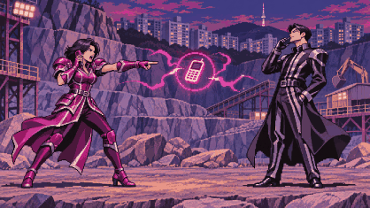

# 핑크는 통화 중

사건 구조 재구성 · 6장 시나리오 초안

**핵심 장치**  모경의 분노는 실제다. 전사와 괴수, 폭발과 얼음은 제범의 머릿속 화면이다. 모경은 특촬 놀이를 하는 사람이 아니다. 두 사람이 화해한 뒤에야 그 이미지를 둘만의 장난으로 쓸 수 있다.

**장 순서**  사랑, 두려움 → 나를 돌아봐 → 우리는 → 다투고 난 뒤 → 또 하루 → 굴레를 벗어나

---

## 제1장. 사랑, 두려움

### S#1. 강릉 바닷가 / 밤

화면은 깜깜하다. 전화 연결음 뒤로 파도 소리가 들어온다. 모경의 목소리가 먼저 들린다.

**모경(전화)**  지금 네 얼굴이 보여. 조금만 더 가까이 오면 내가 말을 못 할 수도 있어.

멀리, 모래사장에 선 제범이 보인다. 휴대전화 화면에는 분홍색 마스크와 하얀 개가 함께 있다. 제범은 한 발을 내딛으려다 멈춘다.

**제범**  그럼 여기 있을게. 끝까지 듣고 싶어.

모경의 입에서 다음 말이 나오기 직전, 화면이 끊긴다.

자막. **세 주 전.**

### S#2. 제범의 차 / 낮

모경이 조수석에서 피보를 안고 강릉 숙소 사진을 보여 준다. 피보가 뛰어놀 수 있는 작은 마당이 있다.

**모경**  여기서 자고 아침에 바다 걷는 거 어때? 피보도 같이.

제범은 운전하면서 사진을 흘낏 본다. 도착까지 세 시간, 주말 고속도로 정체 표시가 내비게이션에 뜬다.

**제범**  네가 요새 많이 피곤하잖아. 내가 편한 데 알아볼게.

**모경**  이 숙소는—

**제범**  응, 저장해 둬. 내가 비교해 볼게.

모경은 입을 닫는다. 제범은 그녀가 동의했다고 받아들인다. 피보만 조수석 안전벨트 사이에서 바닷바람 대신 자동차 바람을 맡는다.

### S#3. 제범의 집 / 이틀 뒤 / 저녁

제범이 예약 완료 화면을 보여 준다. 서울 도심 호텔, 피보를 위한 돌봄 서비스.

**제범**  취소 수수료도 없어. 마음에 안 들면 바꾸면 돼.

그는 말하면서도 이미 달력에 호텔 날짜를 입력한다. 모경은 지도를 열어 서울과 강릉 사이를 손가락으로 움직인다.

**모경**  피보를 맡기려고 했어?

**제범**  우리 둘이 쉬자는 뜻이지. 피보도 좋은 데 있을 거야.

**모경**  알았어.

피보는 모경이 꺼내 둔 산책 가방에 앞발을 얹는다. 모경은 가방을 치우지 않는다. 대신 제범의 얼굴을 본다. 그가 자신을 기쁘게 했다고 믿는 표정이다.

### S#4. 두 집 / 밤 / 보이스톡

제범의 휴대전화에서 피보 사진이 사라지고 분홍색 마스크 프로필이 나타난다. 그는 낯선 번호인 줄 알고 잠깐 망설인다. 이름은 ‘모경’이다.

**제범**  프사 바꿨네.

**모경**  내 얘기를 들은 게 하나라도 있어?

제범은 농담인 줄 알고 웃으려 한다. 모경이 그 틈을 끊는다.

**모경**  내가 바다에 가자고 했어. 피보와 함께. 넌 그 두 가지를 다 빼고 네가 정한 호텔을 내 앞에 내놨어. 그런 다음 마음에 안 들면 바꾸자고 했지. 네가 이미 고른 답을 내가 거절하는 사람이 되게 만든 거야.

**제범**  네가 쉬었으면 해서—

**모경**  또 내 상태를 네가 설명하네. 내가 피곤하다고 했지, 바다에 가기 싫다고 했어?

전화 속 모경의 목소리가 높아진다. 제범의 방 벽이 잠깐 특촬 촬영장의 바위 절벽으로 변한다. 핑크 전사의 실루엣이 폭풍 속에서 일어난다. 제범은 줄무늬 괴수 ‘도글러’가 되어 뒷걸음친다.

**핑크(제범의 상상)**  남의 말을 지우는 괴수, 박멸!

핑크가 손을 뻗는 순간 현실의 제범은 손바닥으로 귀에서 휴대전화를 떨어뜨릴 뻔한다. 방은 원래대로다. 모경은 특촬 대사가 아니라 여행 이야기를 하고 있다.

**모경(전화)**  대답해. 내가 뭐라고 했는지.

**제범**  피보랑 강릉 바다를 걷고 싶다고.

잠깐 침묵. 모경은 더 화를 낼 수 있지만 그러지 않는다.

**모경**  그건 들었네.

통화가 끝난다. 제범은 휴대전화를 내려놓지 못한다.

### S#5. 거리 / 다음 날 / 낮

모경은 피보와 함께 제범을 기다린다. 어젯밤을 모르는 사람처럼 웃는다. 제범은 그 웃음이 무서워진 자신을 보고 더 놀란다.

**제범**  어제 전화… 기억하지?

**모경**  응. 취소하라고 한 적 없는 것도 기억해. 네가 내 말을 되풀이한 것도.

그녀는 피보에게 물을 먹인다. 제범은 ‘다른 사람’이 된 게 아니라고 확인한다. 그럼에도 무슨 일이 일어났는지는 모른다.

---

## 제2장. 나를 돌아봐

### S#6. 회사 휴게실 / 낮

명재희의 가방에 파란 마스크맨 열쇠고리가 달려 있다. 제범은 아무렇지 않은 척 옆에 선다.

**제범**  거기서 핑크는 어떤 캐릭터야?

**재희**  되게 정면으로 가죠. 상대가 변명하면 더 세게 붙고요. 그런데 왜요?

**제범**  그냥. 오래돼서 기억이 안 나.

재희는 괴수 도글러가 매번 쓰러져도 돌아오고, 진짜 권력자는 제바 황제였다고 설명한다. 제범은 자기 이름과 닮은 이름을 듣고 헛웃음을 짓는다.

### S#7. 고깃집 / 일 년 전 / 밤

제범의 기억. 연애 초기에 두 사람이 고기를 굽는다. 옆자리 연인의 큰소리가 점점 거칠어진다. 제범이 고개를 돌린다.

**제범**  저렇게 얼굴 보고 싸우면 다음 날 어떻게 만나냐. 우리 싸우더라도 전화로 하자.

그는 가볍게 말하고 물을 마신다. 모경의 얼굴은 기억 속에서 선명하지 않다. 제범은 그날 자신이 한 말을 중요한 약속으로 여기지 않았다.

### S#8. 모경의 집 / 낮

모경은 제범에게 피보의 첫 산책 사진을 보여 주려다 휴대전화를 내려놓는다. 화면에 열린 메모 제목 ‘표정’이 스친다. 그녀는 급히 앱을 닫고 사진을 연다. 제범은 제목을 본 것 같지만 묻지 않는다.

### S#9. 분식집 / 저녁

제범은 작은 문제부터 바로잡기로 한다.

**제범**  오늘 메뉴 네가 골라. 정말로.

**모경**  순한 떡볶이랑 김말이.

**제범**  좋아. 그런데 여긴 보통 맛이 맛있는데, 한 접시만 그렇게 할까? 오징어튀김도 방금 나왔대.

직원이 앞에 선다. 제범은 잠깐 모경을 보지만 그녀는 이미 ‘아무거나’라는 얼굴이다. 그는 보통 맛을 주문한다. 메뉴가 나오자 모경은 아무렇지 않게 먹는다.

그날 밤. 핑크 프로필의 전화.

**모경(전화)**  네가 ‘우리’라고 말할 때 내가 어디 있는지 모르겠어.

**제범**  오늘은 물어봤잖아.

**모경**  물어본 다음 네 답으로 주문했지. 내가 또 거절하면 내가 예민한 사람이 되니까.

제범의 상상 속 도글러는 ‘우리’라고 쓰인 방패를 든다. 핑크가 방패를 두 동강 낸다. 현실에서 제범은 땀에 젖은 손바닥으로 휴대전화를 바꿔 쥔다.

### S#10. 모경의 집 앞 / 다음 날 / 비

통화로 싸우던 중 제범이 모경의 집 앞에 도착한다. 문을 열자 그녀는 말을 멈춘다. 분노가 꺼진 게 아니라, 입 밖으로 나오는 길을 잃은 것처럼 보인다.

**모경**  비 오는데 왜 우산 없이 왔어?

**제범**  방금 하던 말, 여기서 해도 돼.

모경은 수건을 가져와 그의 어깨에 건넨다.

**모경**  지금은 그 말이 안 나와.

제범은 속으로 ‘핑크가 가면을 벗었다’고 생각한다. 모경은 같은 사람이고 같은 옷을 입고 있는데도, 그의 머릿속에서만 조명이 바뀐다.

---

## 제3장. 우리는

### S#11. 강변 / 낮

진하루는 모경의 오랜 친구다. 제범이 통화와 대면의 차이를 설명하자 하루는 처음으로 제범의 말을 끊는다.

**하루**  모경이는 원래 할 말을 못 하던 아이가 아니야. 친구 괴롭히는 애한테 먼저 달려들었거든. 집에서는 엄마 표정을 살피느라 조용했어. 어른이 화났는지 맞혀야 했으니까.

**제범**  그 버릇이 아직도 있어?

**하루**  그건 내가 대답할 말이 아니지. 네 앞에서는 왜 그런지 모경한테 물어봐.

### S#12. 산책길 / 늦은 오후

피보는 제범이 고른 밝은 큰길을 거부한다. 목줄이 짧게 팽팽해진다. 제범은 끌지 않고 쪼그려 앉는다. 피보가 구석 벤치로 먼저 간다. 모경이 늘 앉던 자리다.

**모경**  얘는 싫은 길이면 몸으로 말해.

**제범**  넌?

모경이 제범을 본다. 그의 표정이 질문인지 추궁인지 읽으려는 순간 피보가 벤치에 뛰어오른다. 모경은 피보를 안고 질문을 넘긴다.

### S#13. 제범의 집 / 밤

모경의 통화가 또 온다. 이번에는 제범이 끝까지 듣지 못하고 자기 말을 끼워 넣는다.

**제범**  전화에서는 날 끝장낼 사람처럼 말해 놓고, 만나면 왜 아무 일도 없는 척해?

**모경**  아무 일도 없는 척하는 게 아니야. 네 앞에 서면 말이 안 나와.

**제범**  그런데 전화로는 잘 나오고?

모경은 대답 대신 영상통화 버튼을 누른다. 제범의 화면에 연결 요청이 뜨자마자 사라진다.

**모경**  미안. 못 하겠어.

제범은 자신의 얼굴이 검은 화면에 비친 것을 본다.

### S#14. 회사 옥상 / 다음 날

재희는 오래된 마스크맨 줄거리를 설명한다. 사랑 때문에 얼음에 갇힌 공주 이알과 갑옷 속에서 왕자처럼 자란 이감. 서로 다른 인물처럼 전해지지만 사실은 같은 가문에서 찢긴 삶이다. 제바 황제는 처음부터 거대한 존재가 아니었고 작은 알에서 자랐다.

**재희**  저는 공주 둘보다 알이 더 무서웠어요. 아무도 신경 안 쓴 동안 안에서 계속 커졌잖아요.

제범은 바닥의 그림자를 본다. 그는 모경을 핑크와 다정한 연인으로 갈라 생각해 온 자신을 알아차린다. 그것을 깨달아도 전화를 받을 때의 공포가 곧바로 사라지지는 않는다.

### S#15. 모경의 집 / 주말 오후

두 사람은 지난 여행 사진을 고른다. 모경이 음료를 사러 나가며 자신의 휴대전화를 제범에게 건넨다.

**모경**  사진 앨범 열어 둔 거야. 네가 나온 사진 골라 줘.

알림이 내려와 화면을 가린다. 제범이 밀어 올리다가 메모 앱으로 넘어간다. ‘표정’. 처음 본 제목이다. 그는 닫아야 한다는 것을 알지만 한 줄을 읽는다.

‘목소리는 괜찮다고 했는데 얼굴은 아니었다. 다음엔 먼저 묻지 말 것.’ 날짜는 두 사람이 처음 사귄 무렵이다. 다른 날에는 식당, 옷, 피보의 병원에 관한 짧은 기록이 있다. 맨 아래 문장은 그를 얼어붙게 한다. ‘얼굴 보고 싸우면 못 만나. 말은 전화로.’

제범은 메모 전체를 훑지 않는다. 이미 본 몇 줄만으로도 누군가가 일 년 동안 자기 얼굴을 채점했다는 느낌을 떨칠 수 없다. 모경이 돌아와 열린 화면을 본다.

**모경**  사진 보라고 준 거였어.

**제범**  알아. 그런데 이게 뭔지 물어봐야겠어.

모경은 음료 두 잔을 탁자에 놓는다. 그녀의 입술이 한 번 열렸다 닫힌다.

---

## 제4장. 다투고 난 뒤

### S#16. 모경의 집 / 계속

**제범**  내가 어떤 표정을 지었는지 이렇게 써 놓으면, 내 말은 다 의심받는 것 같아.

**모경**  네 말을 의심하려고 쓴 게 아니야. 내가 언제 입을 다물어야 하는지 적은 거야.

**제범**  그게 더 무섭다. 넌 내가 화날 거라고 정해 놓고 나한테 묻지도 않았어.

**모경**  나한테 물을 자리를 준 적이 있어?

모경의 목소리가 올라간다. 제범은 처음으로 대면해서 그녀가 화내는 모습을 본다. 그가 놀라는 순간 그녀의 눈이 그의 얼굴에 멈춘다. 목소리가 사라진다.

**모경**  미안. 여기까지 할게.

제범은 그녀가 말을 멈춘 이유를 자기 표정에서 찾는다. 모경은 자신의 방 안에서도 도망갈 곳이 없어 보인다.

### S#17. 계단 / 밤

제범이 나가자 모경의 전화가 온다. 문 하나를 사이에 두고 두 사람은 다시 연결된다.

**모경(전화)**  메모 마지막 줄을 봤으면 알잖아. 네가 그 말을 했어.

제범은 난간을 잡는다. 일 년 전 고깃집의 자기 목소리가 또렷해진다.

**제범**  그냥 옆 테이블 보고 한 말이었어. 우린 싸우지도 않았고.

**모경**  나는 그게 우리 규칙인 줄 알았어. 네 앞에서 화내면 네가 날 다시 안 볼까 봐. 그래서 웃고, 전화해서 그제야 말했어.

**제범**  왜 한 번도 확인 안 했어?

**모경**  네 얼굴을 봐야 하는 질문이니까.

제범은 반박할 말을 찾는다. 그러는 사이 모경이 먼저 전화를 끊는다.

### S#18. 모경의 집 / 같은 밤

모경은 핑크 프로필을 회색 기본 이미지로 바꾼다. 통화창을 닫고 메모를 연다. ‘표정’의 새 줄을 만들려다 키보드를 내린다. 오늘의 제범 얼굴은 기록하지 않는다.

### S#19. 제범의 집 / 같은 밤

제범은 하루에게 보내지 않은 메시지를 쓴다. ‘모경이가 날 괴수 취급했어.’ 곧 지운다. 실제로 괴수의 모습을 상상한 사람은 자신이었다.

상상 속 핑크가 그를 몰아붙이던 화면이 떠오른다. 이어 통화가 끝난 뒤 수건을 건네던 모경이 보인다. 두 장면은 따로 떨어지지 않는다. 둘 다 같은 사람이 한 행동이다.

그는 일 년 전 자신의 말에 악의가 없었다는 사실로 지금의 일을 설명할 수 없다는 걸 안다. 모경도 자신을 무섭게 한 통화를 지워 줄 수는 없다. 그는 전화를 걸지 않는다.

---

## 제5장. 또 하루

### S#20. 나흘의 몽타주

첫날. 모경은 ‘제범이 싫은 이유’라는 제목을 적는다. 첫 항목을 쓰다 멈춘다. 피보가 휴대전화를 앞발로 밀어낸다.

둘째 날. 제범은 혼자 분식집에 간다. 이번에는 순한 맛을 주문한다. 모경에게 사진을 보내려다 자신이 선택의 정답을 찾는 척하고 있다는 생각에 멈춘다.

셋째 날. 모경은 집 앞 편의점에 나오지만 오래 머물지 않는다. 누가 기다리고 있을 거라는 기대와 두려움이 동시에 든다.

넷째 날. 제범은 짧은 음성 메시지를 녹음한다.

**제범(녹음)**  네 메모를 허락 없이 본 건 미안해. 네 전화가 무서웠다는 말도 해야겠어. 나는 그 말을 숨기고 ‘네가 원하는 대로 해’라고만 했어. 그러면서 실제로는 내가 계속 골랐고. 네가 전화를 안 받아도 이건 말해야 할 것 같았어.

그는 전송하고 휴대전화를 뒤집는다.

### S#21. 하루와 모경 / 공원 벤치 / 낮

하루가 피보 산책을 도와주러 왔다. 모경이 전송된 음성 메시지를 듣는다. 하루는 어떤 결론도 대신 내리지 않는다.

**하루**  네가 화낸 이유는 맞을 수 있어. 그렇다고 그 방식 때문에 제범이 겁먹은 것도 없어지는 건 아니고.

**모경**  그 사람 앞에만 가면 내가 내가 아닌 것 같아.

**하루**  그 사람이 보는 얼굴이 네 전부는 아니잖아. 네가 말할 수 있는 자리도 네가 골라.

모경은 피보의 목줄을 하루에게 건넨다.

**모경**  한 바퀴만 더 걸어 줄래? 나는 좀 생각할게.

### S#22. 산책길 / 해 질 무렵

하루가 제범을 불러 목줄을 건넨다. 피보가 앞서간다. 제범은 아무 길도 제안하지 않는다. 피보는 처음 숙소 사진을 봤던 카페 앞, 분식집, 벤치를 지나 집 쪽으로 간다. 제범은 뒤늦게 피보에게 익숙한 길이 자신에게도 익숙하다는 것을 깨닫는다.

모경의 집 앞에서 피보가 앉는다. 제범은 초인종을 누르지 않는다. 하루에게 목줄을 돌려주려는 순간 문 안쪽에서 전화가 울린다. 회색 프로필이지만 이름은 모경이다.

**제범**  문 앞이야. 불편하면 갈게.

**모경(전화)**  알고 있어. 피보가 문 긁는 소리 들렸어.

**제범**  지금 네가 고를 수 있어. 만나도 되고, 전화로만 해도 되고, 오늘은 안 해도 돼.

**모경**  오늘은 전화로. 그리고 내일 강릉에 갈래. 피보랑 바다를 걷고 싶어. 네가 같이 가고 싶은지 물어보는 거야.

제범은 종전처럼 ‘당연히’라고 대답하려다 멈춘다.

**제범**  운전은 긴장되지만 가고 싶어. 중간에 쉬면서 가자. 숙소는 네가 보여 줬던 곳으로 해도 돼?

**모경**  같이 보자. 사진만 보고 정했던 곳이니까.

하루가 피보의 목줄을 받는다. 문은 열리지 않지만, 두 사람은 처음으로 한 문장을 서로의 대답 뒤에 고친다.

### S#23. 각자의 집 / 다음 날 아침

모경의 프로필에 핑크와 피보가 함께 나타난다. 제범은 도글러 대신 제바 황제를 골라 자기 프로필에 올린다. ‘황제’와 이름이 닮았다는 우연 때문에 오래 피한 얼굴이다. 그는 분노의 모든 책임을 ‘전화 속 핑크’에게 떠넘길 수 없다는 뜻으로 그 사진을 고른다.

모경에게 메시지가 온다. ‘제바는 최종 보스잖아.’ 제범이 답한다. ‘그래서 이번에는 도망 안 가려고.’ 모경은 웃는 이모티콘 대신 ‘알겠어’라고 쓴다.

---

## 제6장. 굴레를 벗어나

### S#24. 강릉 / 밤

하루가 운전해 온 차에서 모경과 피보가 내린다. 제범은 먼저 도착해 바닷가에 서 있다. 하루는 피보를 데리고 멀리 걷는다. 모경은 제범과 거리를 둔 채 전화를 건다.

첫 장면의 파도 소리가 다시 들린다.

**모경(전화)**  지금 네 얼굴이 보여. 조금만 더 가까이 오면 내가 말을 못 할 수도 있어.

**제범**  그럼 여기 있을게. 끝까지 듣고 싶어.

모경은 그가 대신 정했던 여행, ‘우리’라고 말하면서 혼자 정했던 식당, 자신의 기분을 그의 표정에서 맞히려던 시간을 하나씩 말한다. 제범도 자신이 느낀 공포를 말한다. 핑크가 전화를 걸 때면 매번 판결이 끝난 다음 법정에 들어가는 기분이었다고.

**모경**  난 네가 악당이라고 생각한 적 없어.

**제범**  알아. 괴수는 내 머릿속에 있었어. 네가 너무 세게 화내면 그렇게 보였어. 네 앞에서는 그 얘기를 못 했고.

모경은 통화를 끊지 않는다. 대신 휴대전화를 귀에서 떼어 스피커로 켜고 모래 위에 내려놓는다.

**모경**  목소리는 여기 두고 갈게. 내가 먼저 가까이 갈게.

제범이 움직이지 않는다. 모경이 걸어온다. 얼굴이 보일 만큼 가까워지자 말이 막힌다. 그녀는 잠시 전화기 쪽을 돌아본다. 연결은 그대로다.

**모경**  네 얼굴이 굳었어. 나 지금 그거 보고 멈추고 싶어. 그런데 멈추면 또 전화로만 말할 것 같아.

**제범**  굳은 건 내가 겁나서야. 네 말이 틀려서가 아니고. 계속해도 돼.

모경은 눈을 피하지 않는다.

**모경**  아직도 화가 나. 내가 피보랑 바다에 오고 싶다고 했는데 네가 서울을 예약한 거. 그걸 말하는 내가 나쁜 사람처럼 느껴졌어.

**제범**  나도 화가 났어. 네가 전화할 때마다 내 변명은 듣지 않을 것 같았어. 그래서 웃는 네 앞에서 괜찮은 척했어. 그건 내 선택이었어.

두 사람 사이의 전화기에서 뒤늦게 서로의 목소리가 작게 되돌아온다. 모경이 먼저 돌아가 종료 버튼을 누른다. 침묵이 와도 떠나는 사람은 없다.

제범의 눈에 한순간 바닷가가 특촬 세트처럼 보인다. 핑크와 제바가 마주 선다. 핑크가 무기를 들지 않고 헬멧을 벗는다. 제바도 망토를 놓는다. 얼음에 갇힌 공주와 갑옷 속 공주가 같은 사람의 두 그림자로 합쳐진다. 모래 아래에서 굴러 나오던 작은 알은 누구의 발에도 짓밟히지 않는다. 제범이 그 알을 내려다본다. 그 안에서 자라던 낡은 규칙이 스스로 금을 내고 무너진다.

현실의 바다. 파도가 전화기를 적시기 전에 제범이 집어 든다. 두 사람은 웃지 않고 잠시 서 있다. 피보가 달려와 둘 사이에 앉는다.

### S#25. 해변 계단 / 조금 뒤

모경은 숙소 주소를 적어 온 종이의 뒷면을 편다. 그들은 ‘다음에 화가 나면’을 함께 적는다.

**모경**  내가 양보할 때는 먼저 원하는 것 하나 말할게.

**제범**  나는 답을 정해 놓고 묻지 않을게. 묻고 나서 기다릴게.

**모경**  전화가 편한 날에는 전화할 거야. 대신 너를 박멸해야 할 괴수처럼 몰아붙이면 멈출게.

**제범**  나도 겁나면 그냥 끊지 않고 겁난다고 말할게.

**모경**  장난이 아프면 ‘변신 해제’.

피보가 계단에서 벌떡 일어나 해변 쪽을 본다.

**제범**  산책길은 피보가 고르는 걸로?

**모경**  피보가 앉으면 한 번 물어보는 걸로. 우리도 가끔 다른 길 가고 싶으니까.

제범은 고개를 끄덕인다. 피보가 모경 쪽을 보고, 모경이 제범을 본다. 세 사람은 그제야 함께 걷는다.

### S#26. 강릉 두부집 / 다음 날

제범이 메뉴를 펼친다. 모경은 피보가 기다리는 야외 자리를 살핀다.

**제범**  나는 순두부가 먹고 싶어. 넌?

**모경**  나는 모두부. 하나씩 시켜서 나눠 먹자.

**제범**  좋아. 피보 산책은 먹고 바로 갈까?

**모경**  십 분 쉬었다가. 내가 그렇게 하고 싶어.

제범은 주문한다. 모경은 휴대전화를 들지 않는다. 필요한 말이 이미 테이블 위에 있다.

### 후일담. 첫눈

겨울, 제범이 장갑 사진을 보낸다. 핑크 프로필의 전화가 온다.

**모경(전화)**  내 손이 시린지부터 물어봤어야지. 제바 황제, 또 혼자 결정했어?

제범은 일부러 장엄한 목소리를 낸다.

**제범**  핑크, 이번 승부는 네가 이겼다.

**모경**  변신 해제. 장갑은 마음에 들어. 내일 끼고 나갈게.

다음 날 모경은 그 장갑을 끼고 온다. 제범이 손이 따뜻하냐고 묻는다. 모경은 그렇다고 대답한다. 눈 쌓인 길 앞에서 피보가 한쪽에 앉는다. 세 사람은 그 길을 보다가, 이번에는 먼저 서로에게 가고 싶은 방향을 묻는다.

